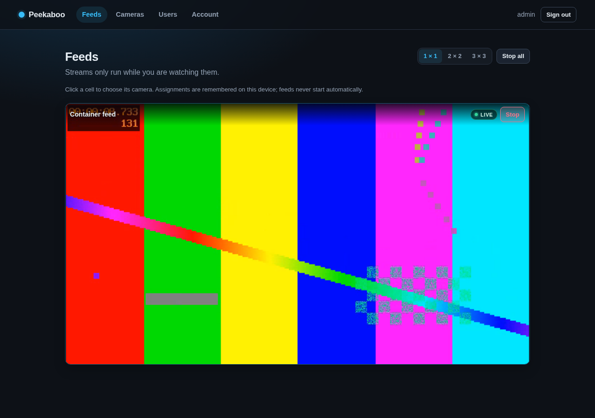

# Peekaboo

A simple, lightweight, self-hosted Hikvision NVR viewer for the web.



Peekaboo is built around one rule: **an NVR channel is only pulled while someone is
actually watching it**. Nothing is streamed on page load, and the server kills the
upstream pull and its ffmpeg process as soon as the last viewer stops watching.
Closing the tab, changing the grid, logging out, or losing the connection all stop the
stream. The same rule applies to recorded playback.

## Features

- **Explicit streaming** — feeds start only when you press **Start** and stop on
  **Stop**, tab hide, navigation, logout, or disconnect.
- **Bandwidth-aware** — one shared upstream pull per camera and stream even if
  several browsers or grid cells watch it; video is copied and audio is
  transcoded to AAC when present; configurable caps. Works over RTSP or the
  Hikvision SDK.
- **Grid layouts** — 1×1, 1×2, 2×1, 2×2 and 3×3; click a cell to assign a camera.
  Layouts and assignments are remembered per device and never auto-start.
- **Playback** — search a camera's NVR recordings over a From/To date-time range,
  explore them on a zoomable, draggable timeline, and play segments in the browser.
  RTSP recordings also expose credential-free RTSP URLs for another player.
- **Motion alarms** — read the NVR's alarm log over ISAPI, pair motion start/stop
  entries into ranges, and show them as day timelines with hover details and direct
  playback links. No persistent alert-stream connection and no local alarm history.
- **NVR and camera management** — add an NVR by IP/hostname (or an explicit RTSP URL),
  choose RTSP + ISAPI or the Hikvision SDK transport, optionally pin its time zone, then
  add cameras with their ISAPI main and sub stream IDs. Stored in SQLite.
- **Main/Sub switching** — feeds use the substream by default and can switch to the
  main stream per cell while live.
- **Accounts** — cookie-based login, PBKDF2 password hashes, admin-managed users.
  No public registration.
- **Self-hosted** — single Docker image (plus an optional private SDK variant),
  SQLite persistence, no external services.
- **Simple UI** — Svelte + TypeScript, responsive down to a phone screen.

## How streaming works

Browsers cannot play RTSP. Peekaboo relays each feed through ffmpeg:

```text
RTSP NVR channel  ─┐
                   ├──ffmpeg (copy video, AAC audio)──▶ fragmented MP4 ──WebSocket──▶ browser MediaSource
SDK PS callback  ──┘
                        │
                        └── started by the first viewer, killed with the last
```

For an NVR using the **Hikvision SDK** transport, Peekaboo logs in over the NVR's
private protocol (default port 8000), starts the channel with
`NET_DVR_RealPlay_V40`, and feeds the resulting MPEG-PS packets into ffmpeg's stdin.
The SDK login is shared by all streams of that NVR and cached after the last viewer
stops to avoid re-authenticating for every search, playback, or jump. It is released
when the NVR configuration changes or the server shuts down. No RTSP or ISAPI
connection is needed for that NVR.

For an RTSP NVR, Peekaboo builds each live-view URL at stream start:

```text
rtsp://<NVR host>[:port]/ISAPI/Streaming/channels/<stream ID>
```

The stream ID selects both the channel and stream type: `101` is channel 1 main,
`102` is channel 1 sub, and `1601` is channel 16 main.

- `ffmpeg` copies the H.264 video stream (`-c:v copy`) and transcodes audio to
  AAC-LC when present, for both RTSP and SDK sources. CPU usage stays low.
- The browser receives `ftyp`/`moov`/`moof`/`mdat` boxes over WebSocket and feeds
  them to a `MediaSource`.
- Streams are refcounted per camera and stream. Two cells watching the same camera
  and stream share one upstream pull; main and sub are separate pulls.
- A 30-second watchdog kills stalled pulls; `PEEKABOO_MAX_STREAMS` caps concurrent
  streams (main and sub count separately) and `PEEKABOO_MAX_VIEWERS_PER_STREAM` caps
  viewers per camera and stream.

### Recorded playback

Recording search uses the NVR's HTTP(S) ISAPI service for RTSP NVRs and the SDK's
`NET_DVR_FindFile_V50` for SDK NVRs.

For RTSP NVRs:

- Peekaboo derives the NVR host from the stored address and probes
  `http://<host>` (port 80) first, then `https://<host>` (port 443) if HTTP is
  unreachable. The working endpoint is cached for 10 minutes. HTTPS is therefore used
  only when the NVR's HTTP service is unreachable or disabled. Set
  `PEEKABOO_ISAPI_HTTP_PORT` when the NVR web interface uses a custom HTTP port;
  `PEEKABOO_ISAPI_INSECURE_TLS=true` accepts self-signed HTTPS certificates.
- It posts a `CMSearchDescription` to `/ISAPI/ContentMgmt/search` with the camera's
  main stream ID as the track ID. Results are capped at 1,000 segments per search and
  31 days per request.
- Playing a segment uses the same ffmpeg/WebSocket relay as live video:

  ```text
  rtsp://<NVR host>[:port]/ISAPI/Streaming/tracks/<main stream ID>?starttime=...&endtime=...
  ```

- Playback sessions are keyed by camera and exact time range. Two viewers watching the
  same range share one ffmpeg pull, and playback counts toward
  `PEEKABOO_MAX_STREAMS`.
- ffmpeg is given a duration cap. Playback uses a 2-minute idle grace for gaps in
  motion-only recordings instead of the 30-second live watchdog. When the recording
  ends cleanly the browser receives `{"type":"ended"}` instead of an error.
- Playback URLs shown in the UI contain the NVR host but **no credentials**. They can
  be copied from the player header into VLC or another RTSP player, where the NVR
  username and password must be supplied separately.
- The recording timeline supports zoom (magnifying-glass buttons) and mouse drag
  panning. Hover or focus a recording for its time range, duration, and codec; click it
  to play.
- Playback starts at the selected segment or time. There is no native timeline
  scrubbing beyond the buffered stream; use **Jump to** and **Play from here** to
  restart the NVR stream at another time.

For SDK NVRs, playback uses `NET_DVR_PlayBackByTime_V50` and the same
ffmpeg/WebSocket relay. It starts at the requested time, stops at the SDK end marker,
and has no shareable URL. Playback speed and startup latency depend on the NVR; on some
models a clip can play slower than real time.

### Motion alarms

Peekaboo can read the NVR's own alarm log instead of holding a live alert-stream
connection. It posts a `CMSearchDescription` to
`POST /ISAPI/ContentMgmt/logSearch`:

```xml
<metaId>log.std-cgi.com/Alarm</metaId>
```

It keeps `motionStart` / `motionStop` entries and pairs them into motion ranges.
Pagination advances by the rows the NVR actually returns, so firmware that returns
64 rows per page is handled correctly.

- The playback timeline shows a **Motion** lane above recording coverage.
- The **Alarms** page renders one timeline per day with a lane per camera. Hover or
  focus an alarm for its target, camera, NVR channel, duration, and a link that opens
  Playback at the alarm time.
- Quick ranges on both **Playback** and **Alarms** are Today, Yesterday, and Last 7
  days. A From/To date-time range is available for anything else.
- Ranges are fetched on demand and cached in memory for 30 seconds. Nothing is written
  to SQLite, so history is limited by the NVR's log retention.
- A query may span at most 31 days.
- The NVR must have motion detection enabled and retain its alarm log. The alert-stream
  "Notify Surveillance Center" permission is not required for this mode.
- Peekaboo reads the NVR's `/ISAPI/System/time` time zone (including DST rules) and
  treats device timestamps as NVR-local wall time. Set a per-NVR IANA time zone in
  **NVRs** if auto-detection is unavailable or wrong.
- Target labels come from the NVR's localized log text (`Osoba`, `Pojazd`,
  `Person`, `Vehicle`, …); Peekaboo normalizes the known values to person/vehicle.
- SDK-transport NVRs still need their HTTP(S) ISAPI service reachable for log search.

See [docs/alarms.md](docs/alarms.md) for the log-search details, API, and
troubleshooting.

## Quick start (Docker)

```bash
cp .env.example .env
# Edit .env: set ADMIN_PASSWORD and, if your NVRs require auth,
# CAMERA_USERNAME and CAMERA_PASSWORD.

docker compose up -d --build
```

Open <http://localhost:8080> and sign in with the admin account from `.env`.

The compose image uses RTSP + ISAPI by default. To use the optional Hikvision SDK
transport, copy the vendor SDK and set `PEEKABOO_DOCKER_TARGET=runtime-sdk`; see
**Optional Hikvision SDK** under Development. The `mise run docker:build` and
`docker:publish` tasks always build the SDK-enabled `runtime-sdk` image.

The initial admin is created **only while the database has no users**. Later
`ADMIN_PASSWORD` changes do not reset it; use the Users page or delete the data
volume to start over.

### Using a published image

Release images use the version from `VERSION` as their tag, so pin that exact tag:

```bash
# .env
PEEKABOO_IMAGE=registry.example.com/peekaboo:0.1.0
```

```bash
docker compose pull
docker compose up -d
```

### Data

SQLite lives in the `peekaboo-data` volume at `/data/peekaboo.db`. To back it
up, stop the container and copy the whole data directory to the host, for example:

```bash
docker compose stop peekaboo
docker compose cp peekaboo:/data ./peekaboo-data-backup
docker compose start peekaboo
```

You can then run `sqlite3 .backup` on the copied database on the host.
`docker compose down -v` deletes all users, sessions, NVRs and cameras.

## NVRs and cameras

In **NVRs**, add an NVR with a name and its address. The simplest form is just the IP
address or hostname:

```text
192.168.1.64
```

By default Peekaboo uses `rtsp://192.168.1.64:554` for live video and tries
`http://192.168.1.64` (port 80) then `https://192.168.1.64` (port 443) for recording
search. An explicit RTSP URL is also accepted, for example
`rtsp://192.168.1.64:8554` or `rtsps://192.168.1.64:322`. Do not include a path,
query, fragment, or credentials — they are rejected.

### Transports

Each NVR uses exactly one transport:

- **RTSP + ISAPI** (default) — live video over the RTSP port; recording search over
  the NVR's HTTP(S) ISAPI service.
- **Hikvision SDK** — live video, playback, and recording search over the NVR's
  private-protocol port (default 8000). The stored address still supplies the host;
  the RTSP port is unused for this transport. The Peekaboo server must have the
  proprietary Linux x86-64 SDK installed (see **Optional Hikvision SDK** under
  Development) and be able to reach the SDK port.

Stream IDs keep the same `channel × 100 + stream type` format. At SDK login Peekaboo
reads the NVR's channel layout and maps the logical channel to the NVR's
digital-channel numbering. A pure-IP NVR commonly starts digital channels at 33, so
stream ID `101` (logical channel 1) maps to SDK channel 33. The mapping is logged at
debug level.

If the NVR web interface uses a custom HTTP port, set it globally:

```env
PEEKABOO_ISAPI_HTTP_PORT=8080
```

This override is HTTP-only; HTTPS on a non-standard port is not supported. If you
require HTTPS, disable the NVR's HTTP service so Peekaboo falls through to port 443.
Self-signed certificates are rejected unless `PEEKABOO_ISAPI_INSECURE_TLS=true` is set
on a trusted network.

Then add a camera under that NVR with:

- a name,
- its **main stream ID**, for example `101`,
- its **sub stream ID**, for example `102`.

An ISAPI stream ID is `channel number × 100 + stream type`, where stream type `1` is
main, `2` is sub, and `3` is third stream. For example, channel 1 main is `101`,
channel 1 sub is `102`, and channel 16 main is `1601`.

Recording search needs an NVR account with remote playback and recording-search
permissions. Motion alarm search needs permission to read the NVR log. Grant those
rights in the NVR's user management.

For RTSP NVRs, at stream start Peekaboo builds:

```text
rtsp://192.168.1.64:554/ISAPI/Streaming/channels/101
```

Do not put credentials in the NVR address. Instead set one global pair on the server:

```env
CAMERA_USERNAME=viewer
CAMERA_PASSWORD=secret
```

The pair is used for every NVR, over RTSP, ISAPI, and the SDK. For RTSP they are
injected into the built URL only at stream start and answered as an HTTP
authentication challenge. For the SDK they are passed to the login call and the
password buffer is cleared afterwards. They never reach the browser and are never
written to SQLite.

> **Feeds default to the substream.** Use the **Sub/Main** switch in a cell to watch
> the main stream. Main and sub are separate ffmpeg pulls and count separately toward
> `PEEKABOO_MAX_STREAMS`. H.264 is the only codec Peekaboo currently relays; H.265-only
> streams and recordings are rejected with a clear error.

> **Upgrading from the URL-based camera model?** Migration 2 removes the old camera
> rows. Re-add each NVR and its cameras once.

## Usage

1. Add NVRs and cameras under **NVRs**. The NVR time zone is detected automatically;
   set an IANA override there if recordings are shifted.
2. Open **Live**, choose a grid layout, and click a cell to pick a camera.
3. Press **Start** in the cell. Use **Sub/Main** to change quality, and **Stop** when
   you are done.
4. Use **Stop all** to release every stream at once.
5. Open **Playback**, choose a camera and a From/To date-time range, then press
   **Search recordings**. Hover or focus a recording on the timeline for details and
   click it to watch. For RTSP NVRs, **Copy stream URL** in the player header copies the
   credential-free RTSP URL for another player. The player has native browser controls;
   drag **Jump to** and press **Play from here** to restart the NVR stream at another
   time. **Close** releases the playback stream.
6. Playback stops on tab hide and resumes from roughly the last position when the tab
   becomes visible again. Navigation, camera changes, and new searches stop it without
   resuming. Changing the time range keeps the current results and player until you
   search again.

Assignments are stored per layout in this browser's `localStorage`; they survive
reloads but never start streams automatically. The selected Playback camera is
remembered per device too. Deleting a camera or NVR clears its feeds the next time the
view loads.

Admins can create and delete users and reset passwords under **Users**. Every user
can change their own password under **Account**.

## Configuration

| Variable | Default | Purpose |
| --- | --- | --- |
| `ADMIN_USERNAME` | — | Initial admin username; required only on first run. |
| `ADMIN_PASSWORD` | — | Initial admin password (8–256 chars); required only on first run. |
| `CAMERA_USERNAME` | empty | Global NVR username, used for every NVR. Set together with `CAMERA_PASSWORD`. |
| `CAMERA_PASSWORD` | empty | Global NVR password. |
| `PEEKABOO_DB_PATH` | `data/peekaboo.db` (`/data/peekaboo.db` in Docker) | SQLite file path. |
| `PEEKABOO_MAX_STREAMS` | `9` | Maximum simultaneously active streams (1–64); live main/sub and playback count separately. |
| `PEEKABOO_MAX_VIEWERS_PER_STREAM` | `8` | Maximum WebSocket viewers per camera and stream (1–64). |
| `PEEKABOO_RTSP_TRANSPORT` | `tcp` | `tcp` or `udp`. TCP is recommended and more reliable. |
| `PEEKABOO_ISAPI_HTTP_PORT` | empty | Optional global NVR web/ISAPI HTTP port. Empty probes 80 then 443. |
| `PEEKABOO_ISAPI_INSECURE_TLS` | `false` | Accept self-signed HTTPS certificates for NVR ISAPI. Trusted networks only. |
| `PEEKABOO_HIK_SDK_PATH` | empty | Directory that directly contains `libhcnetsdk.so` and `HCNetSDKCom` (the SDK `lib` directory). Empty disables the SDK transport. |
| `PEEKABOO_HIK_SDK_CONNECT_TIMEOUT_MS` | `3000` | SDK connect timeout, 1–60000 ms. |
| `PEEKABOO_HIK_SDK_RECONNECT_MS` | `10000` | SDK reconnect interval, 1–300000 ms. |
| `PEEKABOO_HIK_SDK_LOG_LEVEL` | `0` | SDK file log level; `0` disables SDK logging. |
| `PEEKABOO_HIK_SDK_LOG_DIR` | empty | Writable directory for SDK logs; set together with the log level. |
| `PEEKABOO_DOCKER_TARGET` | `runtime` | Compose build target: `runtime` (no SDK) or `runtime-sdk` (private SDK image). The `mise` docker tasks always build `runtime-sdk`. |
| `PEEKABOO_TRUST_PROXY` | `false` | Trust `X-Forwarded-*` headers from a reverse proxy. |
| `PEEKABOO_FFMPEG_PATH` | `ffmpeg` | ffmpeg binary; mainly useful in development. |
| `PEEKABOO_PORT` | `8080` | Host port published by `docker-compose.yml`. |
| `PEEKABOO_IMAGE` | `peekaboo:local` | Image used by `docker-compose.yml`. |

Invalid stream limits, an invalid ISAPI port or TLS setting, an invalid numeric SDK
setting, or a half-configured NVR credential pair fail fast at startup with an
explanatory error. A missing SDK installation is reported only when an NVR configured
for the SDK transport is used, so RTSP-only deployments do not need the SDK.

## Reverse proxy and HTTPS

Put Peekaboo behind TLS for any non-local deployment. A minimal nginx location:

```nginx
location / {
    proxy_pass http://127.0.0.1:8080;
    proxy_http_version 1.1;
    proxy_set_header Host $http_host;
    proxy_set_header X-Forwarded-For $proxy_add_x_forwarded_for;
    proxy_set_header X-Forwarded-Proto $scheme;

    # WebSocket upgrade for NVR streams
    proxy_set_header Upgrade $http_upgrade;
    proxy_set_header Connection "upgrade";
    proxy_read_timeout 1h;
}
```

Then set `PEEKABOO_TRUST_PROXY=true` so the app sees the real client IP, uses
`Secure` session cookies, and validates the forwarded host correctly. Only enable
this when the container port is reachable **exclusively** through the proxy;
otherwise forwarded headers can be spoofed.

## Development

Prerequisites: [mise](https://mise.jdx.dev/), ffmpeg, and (for end-to-end tests) a
Chrome/Chromium build with H.264 support.

```bash
mise install
mise run setup:web
mise run dev
```

- UI: <http://localhost:5173>
- API: <http://localhost:5080>
- Dev admin: `admin` / `peekaboo-dev-password` (from `scripts/dev.sh`; never use
  these defaults in production)

Useful tasks:

| Task | What it does |
| --- | --- |
| `mise run dev` | Backend + Vite dev server. |
| `mise run build` | Build backend and frontend. |
| `mise run test:api` | Backend unit/integration tests. |
| `mise run lint` | ESLint, svelte-check, and e2e type-check. |
| `mise run e2e` | Full Playwright suite with synthetic authenticated RTSP feeds. |
| `mise run test` | Backend tests, then e2e. |
| `mise run docker:build` | Build the `runtime-sdk` image tagged with `VERSION` for `PEEKABOO_REGISTRY`. |
| `mise run docker:publish` | Push that image. |
| `mise run release` | Create the `v<version>` release tag from `VERSION`. |

### Optional Hikvision SDK

The SDK-based NVR transport uses Hikvision's proprietary Linux x86-64 SDK. It is not
distributed with Peekaboo and must not be committed to this public repository. Download
the Linux SDK (tested with `EN-HCNetSDKV6.1.11.40_build20260922_linux64`) from
Hikvision, then copy its `lib` directory into the gitignored `vendor/hikvision`
directory. That directory must directly contain `libhcnetsdk.so` and `HCNetSDKCom`:

```bash
mkdir -p vendor/hikvision
cp -a /path/to/EN-HCNetSDKV6.1.11.40_build20260922_linux64/lib/. vendor/hikvision/
export PEEKABOO_HIK_SDK_PATH="$PWD/vendor/hikvision"
mise run dev
```

`scripts/dev.sh` adds the SDK directory and its `HCNetSDKCom` subdirectory to
`LD_LIBRARY_PATH`. If you start the API by hand, do the same or the SDK's component
libraries will fail to load.

For the private Docker image, either let compose build the SDK target:

```env
PEEKABOO_DOCKER_TARGET=runtime-sdk
```

```bash
docker compose build
docker compose up -d --force-recreate
```

or use the publish tasks, which always build `runtime-sdk` and refuse to push an
image without the SDK:

```bash
mise run docker:publish
```

On the deployment host, recreate the container so the new image is used:

```bash
docker compose pull && docker compose up -d --force-recreate
```

The default `runtime` target contains no SDK and is the safe image for public builds.
Switching targets reuses the same image tag, so always rebuild after changing
`PEEKABOO_DOCKER_TARGET`.

Real-NVR integration tests are opt-in and skipped in CI:

```bash
PEEKABOO_HIK_INTEGRATION=1 \
PEEKABOO_HIK_SDK_PATH="$PWD/vendor/hikvision" \
HIK_TEST_NVR=192.168.10.60 \
CAMERA_USERNAME=viewer CAMERA_PASSWORD=secret \
LD_LIBRARY_PATH="$PWD/vendor/hikvision:$PWD/vendor/hikvision/HCNetSDKCom" \
dotnet test backend/Peekaboo.slnx --filter "FullyQualifiedName~HikvisionIntegrationTests"
```

### End-to-end tests

`mise run e2e` starts MediaMTX (downloaded, checksum-verified and cached under
`e2e/.cache`), pushes four synthetic H.264 feeds at ISAPI paths (main, sub, a second
camera, and a recorded-playback track), starts a fake NVR ISAPI server, starts the app
with a fresh SQLite database, and drives Chromium with Playwright. It verifies real
video decoding (a pixel diff), NVR/camera management, main/sub switching, shared
streams, recording search, playback, and every stop path by counting actual ffmpeg
processes on the host. Ports 5080, 5173, 8555 and 8666 must be free.

The suite is Linux/macOS oriented because it inspects the process table. It is run
in CI on GitHub-hosted Ubuntu with Google Chrome.

## Publishing images

Docker builds and pushes are intentionally local; CI only tests.

Images are tagged with the contents of `VERSION` by default and carry OCI labels for
the version and short Git revision. The `mise` docker tasks build the private
`runtime-sdk` target, so `vendor/hikvision` must contain the Hikvision SDK library;
the build fails early if it does not.

```bash
cp mise.local.example.toml mise.local.toml
# set PEEKABOO_REGISTRY in mise.local.toml (gitignored)

docker login registry.example.com
mise run docker:publish   # registry.example.com/peekaboo:0.1.0
```

The publish task verifies that the image contains `PEEKABOO_HIK_SDK_PATH` before
pushing, so an SDK-free image cannot be released by accident.

Set `PEEKABOO_TAG` only when you deliberately want a different tag. See
[docs/releasing.md](docs/releasing.md) for the release process and version policy.

Registry credentials stay in Docker's credential store. The registry URL and any
tag override stay in `mise.local.toml`, which is gitignored.

## Security

- Session cookies are `HttpOnly`, `SameSite=Lax`, and `Secure` when served over
  HTTPS.
- Passwords use PBKDF2-SHA256 (210,000 iterations) with per-password salts.
- Login attempts are rate-limited per client IP.
- WebSocket upgrades require a session and a same-host `Origin`.
- CSP, `X-Content-Type-Options`, `X-Frame-Options` and `Referrer-Policy` headers are
  set by the server.
- NVR credentials live only in the server environment, the short-lived ffmpeg process
  arguments, HTTP authentication challenges for ISAPI recording search, and the SDK
  login struct (cleared after login). They are not stored in SQLite or sent to the
  browser.
- ffmpeg is started with an argument list (no shell). NVR addresses are host-only — a
  bare IP/hostname or an `rtsp://`/`rtsps://` URL — with paths, queries, fragments, and
  embedded credentials rejected.
- Camera stream IDs must be positive numbers, and the live and playback ISAPI paths are
  built server-side. Clients cannot supply an arbitrary RTSP URL.
- Playback URLs exposed to the browser contain the NVR host but no credentials.

Operational notes:

- Use HTTPS, a strong admin password, and a dedicated NVR account.
- ISAPI recording search over plain HTTP is unencrypted. Peekaboo probes HTTP before
  HTTPS, so disable the NVR's HTTP service if you require HTTPS. Keep NVRs on a
  trusted network in either case. `PEEKABOO_ISAPI_INSECURE_TLS=true` disables
  certificate validation for NVR ISAPI requests and should only be used on a trusted
  network.
- The SQLite volume contains password hashes, NVR addresses and camera names/IDs;
  protect and back it up accordingly.
- Motion alarm history is fetched from the NVR on demand and is not stored by
  Peekaboo, but it is readable by every authenticated user, consistent with camera
  visibility. Alarm logs can reveal occupancy and movement patterns.
- Peekaboo is designed for a trusted self-hosted network. It is not multi-tenant.

See [SECURITY.md](SECURITY.md) for reporting a vulnerability.

## Limitations

- H.264 only; no video transcoding or H.265 support for live streams or recordings.
- Audio is transcoded to AAC-LC and only available when the source recording or
  live stream actually contains an audio track. Audio support has been verified
  with Hikvision RTSP and SDK MPEG-PS sources; unusual source audio encodings may
  fail to decode.
- 1–3 second latency (depends on the NVR/camera GOP/encoder settings).
- One app instance per database; streaming state is in-process and not clustered.
- No in-app recording, export/download, PTZ controls, or automatic live-stream
  reconnect (reconnect is deliberately manual so a stopped stream cannot start itself).
- No automatic NVR channel discovery; add camera stream IDs manually.
- For RTSP NVRs, recording search requires the NVR's HTTP(S) ISAPI service to be
  reachable from the Peekaboo server, and the NVR account needs remote
  playback/recording-search rights. A custom web port is global via
  `PEEKABOO_ISAPI_HTTP_PORT`; HTTPS on a non-standard port is not supported, and
  self-signed HTTPS certificates need `PEEKABOO_ISAPI_INSECURE_TLS=true`.
- The Hikvision SDK transport is optional, proprietary, and only available on Linux
  x86-64. The default image and public repository do not include it. The NVR's private
  protocol port (default 8000) must be reachable.
- SDK live view and playback still pass through ffmpeg and remain H.264-only. SDK
  playback speed and startup latency depend on the NVR and can be slower than real
  time; SDK recordings have no shareable URL.
- SDK recording search returns file-level segments and does not report a codec type.
- A search can span at most 31 days and returns at most 1,000 segments; a single
  playback stream can span at most 24 hours.
- Playback starts at the selected segment or time; the timeline supports zoom and
  horizontal panning, but native seeking is limited to the buffered stream. Use
  **Play from here** to restart the NVR stream at another time.
- NVR clock auto-detection needs `/ISAPI/System/time`. If the NVR's timestamps are
  still shifted, set an explicit IANA time zone (or `UTC`) on the NVR.
- Motion alarms are read directly from the NVR log and are not persisted by Peekaboo.
  History is limited by the NVR's log retention.
- Only `motionStart` / `motionStop` alarm subtypes are displayed. Other NVR alarm
  subtypes are ignored.
- Target labels depend on the NVR's localized log text. Unrecognized labels are shown
  as generic motion, and ranges that cross the requested window are marked with an
  estimated start or end.
- RTSP playback URLs are credential-free. Opening one in VLC or another player
  requires the NVR username and password separately. SDK playback has no URL.
- One global NVR credential pair for now.
- Live main/sub and recorded playback count toward the same `PEEKABOO_MAX_STREAMS`.
- Live main and sub streams of the same camera count as two concurrent streams.
- Grid assignments and the selected Playback camera are per browser/device, not per
  account.

## License

MIT — see [LICENSE](LICENSE).
